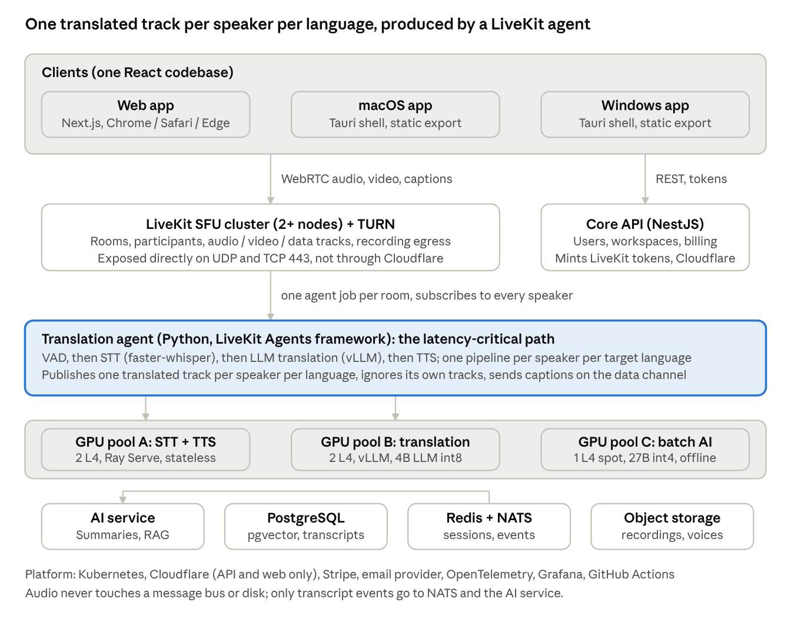
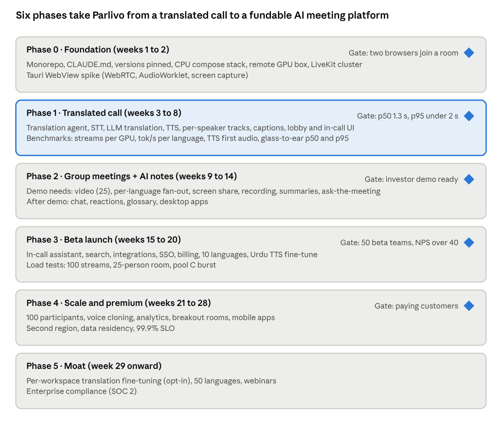

# Parlivo – Multilingual AI Meeting Platform

## Architecture Document

Oct 22, 2026 · @Haider

## 1. Product overview

Parlivo is a video meeting platform, in the category of Zoom, Google Meet and Microsoft Teams, where every participant speaks and hears in their own language, and an AI layer turns each meeting into searchable, actionable knowledge. The wedge is real-time voice translation; the moat is the AI that compounds on top of it.

**Working name.** Parlivo (from the French parler, to speak). Web search shows no existing app, company or product with this name; a formal trademark search (USPTO, EUIPO) and domain registration are required before launch.

**Core user story.** A team in Berlin, Madrid and São Paulo joins one Parlivo meeting hosted in the EU region. Each person speaks their own language. About 1.3 seconds after a speaker finishes a clause, everyone else hears it in their chosen language in a natural voice, with live captions. A colleague joining from Lahore hears the same, about 200 ms later, and if they choose Urdu they get Urdu captions and translated text with English or Hindi voice until Urdu voice ships. After the call, every participant gets a summary and action items in their own language and can ask the meeting assistant "what did Anna commit to?" in any language.

### Positioning for investors

- Microsoft Teams (Interpreter agent, needs a Copilot license) and Google Meet (Gemini speech translation, premium tiers) both ship real-time translated speech. Zoom offers translated captions. All three are add-ons to an English-first product, gated behind their top paid tiers, and limited in language pairs.
- Parlivo's wedge: translation is on for every participant by default, any language to any language, at a price at or below a standard Zoom seat, because the models are open-weight and self-hosted.
- The moat is the AI layer: summaries, action items, search and the in-call assistant all work in each participant's own language, and the workspace glossary and corrected transcripts (opt-in) improve that workspace's translation quality over time.
- Market: the video-conferencing market is estimated at $30 to 40 billion annually; cross-border teams, outsourcing, international sales, education and healthcare are the first segments. Replace this with a cited figure before it goes in a deck.

### Goals

- Group video meetings up to 25 participants at launch, 100 by phase 4, each hearing their own language.
- Glass-to-ear translation latency p50 1.3 s and p95 under 2 s in-region (p50 1.5 s, p95 2.5 s cross-continent) for the launch languages.
- Self-hosted open-weight models keeping the blended cost under $0.01 per participant-minute once volume passes about 10,000 participant-minutes per day (the fixed GPU floor dominates below that).
- One codebase for web, macOS and Windows; a polished, animated UI that feels premium.
- An AI layer (section 7) that is a reason to switch, not a checkbox.
- Horizontally scalable to thousands of concurrent meetings without rewrites.

### Non-goals (v1)

- Training custom speech or translation models from scratch (fine-tuning is phase 5).
- Mobile apps (iOS/Android); the API is designed so they can be added in phase 4.
- Webinars and broadcast to 1,000+ viewers.
- Phone dial-in (PSTN).

### Open questions

- Launch languages: English, Spanish, German, French, Portuguese, Arabic, Hindi, Mandarin, Japanese, Italian (all covered by the chosen STT, translation and TTS models with commercial licenses). Urdu ships as captions plus translated text at launch; Urdu voice output requires a TTS fine-tune (phase 3 task).
- Fixed neutral voice per language at launch; the speaker's own cloned voice (VoxCPM2 or Chatterbox) as a phase 4 premium feature with recorded consent.
- Free tier: 40-minute meetings, 3 participants, 2 languages, mirroring Zoom's funnel.
- Legal name: trademark search (USPTO, EUIPO) and parlivo.com registration are open tasks.

## 2. System architecture

The system is three tiers: thin clients, a LiveKit media tier with a Python translation agent inside it, and a core API plus AI service behind it. The latency-critical path is the translation agent and GPU pools A and B; everything else is ordinary stateless services.



system architecture v2 · clients, LiveKit, translation agent, AI service, GPU pools, data

A speaker's audio enters the LiveKit SFU over WebRTC. One translation agent job joins each room as a hidden participant, subscribes to every human audio track, and runs one streaming pipeline per speaker per target language present in the room. The synthesized audio is published back into the same room as a separate track named translated-{speakerId}-{lang}. Each listener subscribes to the translated tracks of every other speaker in their chosen language, keeps the original track for speakers of their own language, and never subscribes to translations of their own speech. Captions travel on the LiveKit data channel from the same agent.

**Key design decisions** (each recorded as an ADR in docs/adr/)

| Decision | Choice | Why |
|---|---|---|
| Media transport | LiveKit (Apache 2.0 SFU), self-hosted, 2-node cluster from day one, plus coturn for TURN | Sub-100 ms transport, NAT and firewall traversal on TCP/TLS 443, room model, recording egress, data channels |
| Audio processing | LiveKit Agents framework (Python) | Subscribes to tracks, publishes tracks back, dispatches one job per room; replaces custom Go ingress/egress services and any message bus on the audio path |
| Translation fan-out | One pipeline per speaker per target language | No self-echo, overlapping speakers stay on separate tracks, listeners keep speaker attribution; cost scales with active speakers times languages |
| Captions and events | LiveKit data channel to clients; NATS JetStream for durable transcript events to the AI service | One WebSocket per client (LiveKit's own); audio never touches NATS or disk |
| Pipeline placement | Server-side GPU workers | Consistent quality on any laptop; models upgrade without app releases |
| GPU pools | Three separate pools: realtime STT+TTS, translation LLM, batch AI LLM | Summaries and RAG never compete with live translation |
| Translation model | Qwen3 4B (Apache 2.0) at int8 via vLLM as the default; Qwen3 8B or Gemma 4 at int4 with speculative decoding as the quality upgrade if the phase 1 tok/s benchmark allows; MADLAD-400 3B (Apache 2.0, seq2seq, no prompting) for long-tail languages | Commercial license; on an L4 (about 300 GB/s) single-stream decode speed is bandwidth-bound, so a 4B int8 model (about 60 to 70 tok/s) is the only size that fits the budget; prompts carry glossary, context and formality on the LLM path only; NLLB-200 and Tower are non-commercial and excluded |
| TTS model | VoxCPM2 (Apache 2.0, 30 languages, cloning) primary; Chatterbox Multilingual (MIT) alternate; Kokoro (Apache 2.0) for lowest-latency English | Commercial licenses; cover all launch languages except Urdu voice |
| API language | TypeScript (NestJS) | Shares types with the frontend; team's skill set; no Go in the stack |
| ML serving | Ray Serve, stateless replicas | Standard ML ecosystem, autoscaling, batching; the agent owns every per-speaker buffer and context, so any replica serves any request |
| Desktop shell | Tauri 2 | Small binaries, Rust core, native audio permissions; requires a static Next.js export |

## 3. Technology stack

Every model and framework below permits commercial use; the recurring costs are GPU hosting, Stripe fees, an email provider, code-signing certificates and managed Kubernetes. Versions are not pinned here: CLAUDE.md requires Claude Code to pin the current stable release of each dependency at project start and record it in docs/versions.md.

| Layer | Technology | License | Notes |
|---|---|---|---|
| Frontend framework | React 19 + TypeScript, Next.js (current major, App Router) | MIT | SSR for marketing and auth; the call screen and the desktop build use static export |
| UI library | Ant Design 6 + Framer Motion + Tailwind | MIT | Ant D 6 requires React 18+; theme tokens override every default |
| State | Zustand (client), TanStack Query (server) | MIT |  |
| Desktop shell | Tauri 2 (Rust) | MIT / Apache 2.0 | Static Next.js export, deep-link OAuth, auto-update, tray |
| Realtime media | LiveKit server + livekit-client SDK + coturn | Apache 2.0 / MIT | 2-node SFU cluster, Redis-routed; TURN on TCP/TLS 443 |
| Translation agent | LiveKit Agents (Python) | Apache 2.0 | One job per room; subscribes, processes, publishes tracks and data |
| Core API | NestJS (TypeScript), Prisma ORM | MIT / Apache 2.0 | Auth, workspaces, guests, LiveKit token minting, billing |
| AI service | Python, FastAPI | MIT | Summaries, RAG, extraction, analytics |
| Database | PostgreSQL + pgvector | PostgreSQL / PostgreSQL | Primary store and vector index |
| Cache | Redis | RSALv2 / SSPL (or Valkey, BSD) | Sessions, rate limits, LiveKit routing |
| Events | NATS JetStream | Apache 2.0 | Durable transcript and meeting events only; never audio |
| Object storage | S3-compatible (Cloudflare R2 or MinIO) | n/a / AGPL | Recordings, voice profiles, exports |
| Speech to text | faster-whisper (CTranslate2), Whisper large-v3-turbo, Silero VAD | MIT / MIT / MIT | Streaming, int8 on GPU |
| Translation | Qwen3 4B int8 via vLLM (default); Qwen3 8B or Gemma 4 int4 with speculative decoding (upgrade path); MADLAD-400 3B for long-tail languages | Apache 2.0 / Apache 2.0 / Apache 2.0 | Final choice by nightly COMET benchmark per language pair; Gemma 4 moved to Apache 2.0 in April 2026 (verify sizes and terms at pin time); MADLAD cannot take glossary, context or formality prompts |
| Text to speech | VoxCPM2 2B (primary, 30 languages, cloning); Chatterbox Multilingual (alternate, 23 languages); Kokoro 82M (fastest English) | Apache 2.0 / MIT / Apache 2.0 | VoxCPM2 specs (2B, 30 languages, Apache 2.0, April 2026) are from its Hugging Face model card; first-audio latency is unverified and is a phase 1 benchmark. Chatterbox Multilingual (MIT, 23 languages) is the confirmed fallback and covers every launch language. No permissive model covers Urdu voice yet |
| AI LLM (batch) | Qwen3 32B or Gemma 4 27B int4 via vLLM on pool C; one non-spot replica from phase 3 for the in-call assistant | Apache 2.0 | Summaries, RAG answers, extraction |
| Embeddings | bge-m3 | MIT | Multilingual, 100+ languages |
| ML serving | Ray Serve, PyTorch (current stable), CUDA | Apache 2.0 / BSD | Autoscaling stateless replicas, dynamic batching |
| Containers / orchestration | Docker, Kubernetes (k3s for dev, managed k8s for prod) | Apache 2.0 | Separate node pools for GPU A, B, C and CPU |
| Edge / CDN | Cloudflare | commercial, free tier | Web and API only; WebRTC media is not proxied |
| Billing / email | Stripe; Resend or Postmark | commercial | Pay per use |
| Observability | OpenTelemetry, Prometheus, Grafana, Loki | Apache 2.0 / AGPL | Per-stage latency histograms |
| CI/CD | GitHub Actions | commercial, free tier | Lint, test, build, deploy; Tauri builds signed for Mac and Windows |
| Monorepo | pnpm workspaces + Turborepo | MIT | Shared TypeScript types |
| Testing | Vitest, Playwright, pytest, k6 | MIT / Apache 2.0 / MIT / AGPL | k6 for concurrent-call load tests |

**Hosting estimate (launch).** Five L4-class GPUs for redundancy (2 in pool A, 2 in pool B, 1 spot in pool C) at about $0.60 per hour each are about $2,200 per month on their own. Two 4-vCPU VMs for LiveKit, two for API and services, managed PostgreSQL, managed Kubernetes, TURN egress and object storage add $600 to $1,000. Fixed monthly floor: about $2,800 to $3,200 before any usage. From phase 3 a sixth, non-spot L4 for the in-call assistant adds about $440. At launch volume this floor, not the per-minute figure in section 5, is the real cost; the per-minute figure matters once utilization is above about 30%.

## 4. Real-time translation pipeline

The pipeline is a streaming chain that runs per speaker per target language inside the LiveKit translation agent. Every stage emits output as soon as it has something, but translation starts only when a clause is complete, so the listener hears each clause about 1.3 seconds after the speaker finishes it (in-region), not before.

**Definition of glass-to-ear latency.** The time from the last voiced audio frame of a source clause (before the silence window that closes it) to the first translated audio sample played at the listener. The 300 ms silence window is therefore inside the measurement. This is what the targets, SLOs and the phase 1 gate measure. Time spent speaking the clause is not included, and the document makes no claim that translation arrives before the speaker finishes.

### Per-clause flow

- Client captures microphone at 48 kHz with browser echo cancellation and noise suppression and publishes Opus over WebRTC to LiveKit.
- The translation agent for the room subscribes to the track (LiveKit resamples to 16 kHz PCM in memory) and runs Silero VAD on 20 ms frames. The agent ignores its own published tracks.
- On speech, the agent sends the speaker's accumulating clause buffer to any available STT replica. Partial transcripts return every 500 ms for captions only. When VAD detects 300 ms of silence or the transcript ends in terminal punctuation, the clause is finalized. A clause is force-finalized at 7 seconds of continuous speech at the nearest word boundary, so a speaker who never pauses still produces translation. The agent keeps each speaker's audio buffer itself and sends whole clauses (and the growing buffer for partials) to STT, so STT replicas are stateless and need no session routing.
- The final clause goes to the translation LLM once per target language present in the room, with the speaker's previous two clauses as context, the workspace glossary, and the listener-chosen formality. Output streams token by token.
- TTS starts as soon as the translated clause is complete (clauses average 1 to 3 seconds of speech, so waiting for the whole clause costs little and avoids broken prosody). The TTS replica streams PCM chunks back to the agent.
- The agent pushes the chunks into a LiveKit AudioSource for the track translated-{speakerId}-{lang}. Listeners subscribed to that track hear it through the normal WebRTC path, so their echo cancellation still applies.
- In parallel, partial and final transcripts plus translations go to clients as caption messages on the LiveKit data channel (2 updates per second per speaker). Final transcripts are published to NATS JetStream for the AI service.

### Latency budget, in-region (p50 target 1.3 s, p95 ceiling 2.0 s)

| Stage | Target | Notes |
|---|---|---|
| Mic to SFU to agent (WebRTC, one hop) | 80 ms | Opus 20 ms frames, jitter buffer, in-region |
| VAD endpoint detection | 300 ms | The silence window that defines a clause end; tunable per language |
| STT final pass on the clause | 150 ms | faster-whisper turbo int8 on L4, clause of 1 to 4 s |
| Translation, full clause | 350 ms | 4B int8 on vLLM: 50 ms prefill, 15 to 20 output tokens at the L4's bandwidth-bound ceiling of about 65 tok/s; Arabic, Hindi and Japanese produce more tokens per clause and sit at the upper end |
| TTS first audio chunk | 150 ms | VoxCPM2 streaming; Kokoro 80 ms for English |
| Agent to SFU to listener (WebRTC, second hop) | 100 ms | Including playout buffer |
| Batching and scheduling waits | 60 ms | 20 ms cap at each of three GPU stages |
| Total | 1,190 ms | About 100 ms headroom to the 1.3 s p50 target; measured tok/s per language and TTS first-audio time are phase 1 gates |

**Cross-region.** The budget above assumes all participants are within about 40 ms of the server. A participant on another continent (Lahore or São Paulo on a Frankfurt meeting) adds about 100 to 150 ms on each WebRTC hop, so the cross-continent targets are p50 under 1.5 s and p95 under 2.5 s. The investor demo is run with all participants in-region, or is presented with the cross-region target stated.

If the phase 1 benchmark measures real decode at the usual 70 to 80% of the theoretical ceiling and the budget overruns, the decision is pre-made: first move the in-region p50 target to 1.5 s; if the product needs 1.3 s, move pool B to L40S-class GPUs (about 860 GB/s) at roughly double the per-GPU cost. Incremental translation (committing stable partial transcripts with the LocalAgreement policy so translation starts mid-clause) is a phase 3 experiment that could cut 300 to 500 ms; it is not assumed anywhere in this document.

### Multiple speakers and backlog policy

- Each speaker's translation is its own track, so overlapping speech produces overlapping translated tracks, exactly as the original audio overlaps.
- Tracks are published lazily: a translated-{speakerId}-{lang} track exists only while that speaker has spoken in the last 30 seconds and at least one listener wants that language. A 25-person, 9-language room therefore carries a handful of live translated tracks, not 225. Track creation and permission updates start on the first voiced frame, before the clause ends, so a returning speaker's first clause is not delayed by setup.
- Subscription control: LiveKit tokens grant room-level subscribe; the agent calls the per-track subscription permission API so each participant can subscribe only to the translated tracks of their chosen language. A language switch is one data-channel message to the agent, which starts the pipeline if needed, updates the participant's track permissions, and the client swaps subscriptions.
- Translated speech is often 20 to 40% longer than the source (German, French). Each translated track keeps a playout queue; when the queue exceeds 3 seconds the agent speeds playback up to 1.25x, when it exceeds 6 seconds it drops the oldest clause and shows it as caption only with a "skipped" marker. The listener sees a small lag indicator.
- Agent crash recovery: LiveKit re-dispatches the room's agent job within a few seconds; clients show "translation reconnecting" and keep original audio and chat; clauses spoken in the gap are lost for translation and are marked missing in the captions and transcript.
- Recording captures the original audio and video of all participants plus every translated track as separate audio files, so a playback can be heard in any language that was active in the meeting.

### Quality safeguards

- The speaking language chosen in the lobby is authoritative. Whisper's language detection runs only to flag a mismatch ("you selected German but seem to be speaking English"); code-switching between Urdu and English stays in the user's chosen primary language.
- Partial transcripts appear in captions in a lighter colour and are replaced when finalized.
- Two clauses of context prevent pronoun and gender errors; the glossary is injected into the LLM prompt; formality is a prompt instruction. None of these depend on a seq2seq model.
- If a stage exceeds its budget three times in a row, the pipeline degrades to captions only for that speaker-language pair, with a UI notice.

### Model serving

- Pool A runs STT and TTS as stateless Ray Serve deployments; the agent owns every per-speaker buffer, so any replica can serve any request. Pool B runs the translation LLM on vLLM with continuous batching across rooms; pool C runs the batch AI LLM and never serves the live path.
- STT (whisper turbo int8, about 1.5 GB) and TTS (VoxCPM2 2B fp16, about 5 GB) share a 24 GB L4 with headroom for batching. The 4B translation LLM at int8 (about 4.5 GB plus KV cache) takes its own L4 so that decode bandwidth is not shared with STT and TTS.
- One replica of each model is always warm; autoscaling adds replicas at 70% queue utilization.

## 5. Scalability and performance

Capacity is planned in streams, and the number of streams one GPU can carry is measured in phase 1, not assumed. Everything above the GPU pools scales by adding stateless pods; the stateful parts (SFU rooms, the per-room agent job, PostgreSQL) each have a defined scaling path.

**Unit of capacity.** One stream = one speaker being translated into one target language. A 4-person meeting with 3 languages has at most 4 speakers times 2 other languages = 8 streams, but only the speakers currently talking consume GPU time, so sustained load is about 2 streams per such meeting (one active speaker, two target languages).

### Planning assumptions until measured

| Resource | Planning figure | How it is verified |
|---|---|---|
| Pool A (STT + TTS), one L4 | 10 concurrent active streams | Phase 1 gate: benchmark with synthetic speakers at p95 under 2 s; the real number replaces this figure in the doc |
| Pool B (translation LLM), one L4 | 40 concurrent active streams | 4B int8; batching raises throughput but not per-stream speed, so the per-stream tok/s ceiling (about 65) is the phase 1 gate |
| Pool C (batch AI), one L4 spot | Summaries, summary translation, RAG indexing and extraction for the launch cohort; a 27B int4 model processes roughly 2,000 to 3,000 input tok/s, so 100 hour-long calls ending together take several minutes | Summary p95 under 5 minutes after call end; spot reclaim delays, never drops, the job; the interactive in-call assistant (phase 3) runs on a separate non-spot replica with a priority queue |
| LiveKit node, 4 vCPU | About 500 audio+video participants | LiveKit published benchmarks; verified in load test |
| Core API pod | About 2,000 req/s | k6 |

**Cost per minute.** Unit throughout this document: participant-minute (one person in a meeting for one minute). At the planning figure, one L4 at $0.60 per hour serving 10 active streams costs $0.001 per active-stream-minute for pool A, plus $0.00025 for pool B. A 4-person, 3-language meeting at 2 sustained streams costs about $0.0025 per meeting-minute in GPU, or roughly $0.0006 per participant-minute. With SFU, API, TURN egress and pool C overhead the all-in marginal cost is $0.001 to $0.002 per participant-minute. The fixed floor of $2,800 to $3,200 per month (section 3) dominates until utilization passes about 30%; at 10,000 participant-minutes per day the blended cost is about $0.01 per participant-minute, at 100,000 it approaches the marginal figure. All numbers are restated after the phase 1 benchmark.

### Scaling each tier

| Tier | State | Scaling strategy |
|---|---|---|
| LiveKit SFU | Rooms pinned to one node | 2-node cluster with Redis routing from day one; add nodes |
| Translation agent | Per-room job | LiveKit Agents dispatches jobs across agent workers; add workers |
| STT / TTS replicas | None (the agent holds every buffer) | Stateless Ray Serve replicas; autoscale on queue depth at 70% |
| Translation LLM | Per-call context (two clauses) kept by the agent, not the LLM | Stateless replicas, continuous batching |
| Core API, AI service | None | Horizontal pod autoscaler on CPU |
| PostgreSQL | Primary | Read replica, PgBouncer, monthly partitions on transcripts |
| NATS JetStream | Durable streams | 3-node cluster; one stream per subject family, not per call |

### Latency under load

- Autoscaling triggers at 70% queue utilization so replicas are warm before saturation.
- Dynamic batching is capped at 20 ms wait per stage.
- Backpressure: if a GPU queue exceeds 1 s, new streams for that pool degrade to captions only until it recovers; existing streams keep audio.
- Regions: launch in one region (Frankfurt). A meeting is pinned to the host's workspace region; guests from other continents accept the extra WebRTC hop. A second region and data-residency choice arrive in phase 4.

### Redundancy and availability

- Single region at launch, so the honest SLO is 99.5% monthly until phase 4; 99.9% requires two regions.
- Within the region: 2 SFU nodes, 2 GPUs in pool A and 2 in pool B (the five-GPU launch configuration in section 3), multi-replica API and agent workers, managed PostgreSQL with failover. Pool C is single and spot because its work is deferrable. Launch capacity in pool A is 2 GPUs at about 10 streams each with one held for failover, so about 10 concurrent active streams, or roughly 5 four-person meetings at once; the 50-team beta will need pool A at 3 to 4 GPUs, and the floor rises accordingly.

### Code-level performance rules

- Audio flows SFU to agent to GPU to agent to SFU only; it never touches the API, NATS or disk.
- No per-clause database writes; transcripts are batched to PostgreSQL every 5 seconds and on call end.
- Frontend: the call screen is a client-only route, audio metering runs in an AudioWorklet, caption components are memoized and updated at 2 Hz.
- One signalling WebSocket per client (LiveKit's); captions and events travel on the WebRTC data channel, not on the signalling socket, so there is no second application WebSocket.

### Load tests before beta (phase 3 gate)

- 100 concurrent active streams (for example 50 four-person meetings, each with two target languages) on pool sizes derived from the phase 1 benchmark, p95 glass-to-ear under 2 s in-region.
- One 25-participant meeting with 5 languages and 3 people talking over each other, verifying lazy track publishing keeps live translated tracks under 20 and p95 under 2 s.
- 1,000 concurrent participants across 2 SFU nodes with no dropped frames at 5% simulated packet loss.
- 50 thirty-minute calls (about 300k input tokens) ending within one minute on one pool C GPU: every summary delivered, p95 under 5 minutes, no live-path latency regression during the burst. Larger bursts are expected to take proportionally longer; pool C is sized to the measured rate before beta.

## 6. Frontend and UI architecture

One React codebase ships to web, macOS and Windows; the UI is built on Ant Design 6 with a custom design token theme so it looks premium rather than default.

### Design direction

- Dark-first theme with a light mode; glassmorphism panels, 8 px grid, Inter font, one accent colour per brand.
- Ant Design's ConfigProvider theme tokens override every primary colour, radius and shadow so nothing looks stock.
- Framer Motion for every state change: joining a call, language switching, caption arrival, speaker glow.
- A live audio visualizer (Canvas or WebGL, AudioWorklet-driven) shows both the original and the translated stream.

### Screens (v1)

| Screen | Purpose | Key components |
|---|---|---|
| Landing / marketing | Explain the product, sign up | Next.js SSR, hero animation (web only, not in the desktop build) |
| Auth | Sign in, sign up, magic link | Ant D Form, OAuth (Google, Apple, Microsoft) |
| Dashboard | Start a call, invite link, recent calls, usage | Ant D Table, Card, Statistic |
| Pre-call lobby | Pick mic, speaking language, listening language, test audio | Ant D Select with flag icons, live VU meter |
| In-call | The core screen: participants, captions, translated audio, screen share, chat, controls | Custom layout, Framer Motion, Canvas visualizer |
| Settings | Profile, default languages, voice preference, audio devices | Ant D Tabs, Form |
| Admin (internal) | Usage, latency, GPU health | Ant D Table, Grafana embeds |

### In-call screen anatomy

- Top bar: call title, elapsed time, connection quality badge, language pair chip ("EN to DE").
- Centre: participant tiles with speaker glow, each showing their speaking language and what they are hearing.
- Caption rail: two-line rolling captions, original in grey, translation in white, partials in italics.
- Bottom dock: mute, change listening language (instant switch, no rejoin), original audio volume slider, captions toggle, leave.
- Language switch is one data-channel message; the client swaps track subscriptions as soon as the new pipeline publishes (about 2 seconds for a language with no existing pipeline, instant for one already running).

### Frontend code structure

```
apps/
  web/            Next.js app (also the Tauri webview target)
  desktop/        Tauri 2 shell: Rust src-tauri, auto-update, tray, permissions
packages/
  ui/             Ant D theme, shared components, Framer presets
  audio/          AudioWorklet processors, device management, VU meter
  realtime/       LiveKit client wrapper, track subscription rules, data-channel caption and event types
  types/          Shared TypeScript types generated from the API (OpenAPI)
  i18n/           UI translations (the app itself in 10 languages)
```

### Desktop specifics (Tauri)

- The desktop build is a static Next.js export (output: 'export'); marketing and auth pages that need SSR live on the web only, and the desktop app opens straight into the dashboard.
- OAuth uses the system browser with a parlivo:// deep link back to the app (Tauri deep-link plugin).
- Phase 0 spike: WebRTC, AudioWorklet and screen capture inside macOS WKWebView and Windows WebView2, before committing to Tauri over Electron.
- Native microphone, camera and screen-recording permission prompts on macOS; code-signed and notarized builds (Apple Developer and Windows code-signing certificates are paid).
- Auto-update via Tauri updater with signed releases; global hotkeys for mute and push-to-talk; system tray with status.
- Windows: MSI and NSIS installers; macOS: universal DMG (Intel + Apple Silicon).

## 7. AI features

Translation gets users in the door; these features make Parlivo the system of record for a multilingual team and are the core of the seed pitch. They run on GPU pool C with one open-weight LLM (Gemma 4 27B or Qwen3 32B at int4, Apache 2.0), separate from the live-translation pools, so they never affect call latency; their cost is one spot GPU at launch plus one non-spot replica for the in-call assistant from phase 3.

| Feature | What the user sees | How it works | Phase |
|---|---|---|---|
| Live multilingual captions | Captions in each viewer's language, speaker-attributed, searchable during the call | STT + translation stream from the pipeline, diarization by track | 1 |
| Meeting notes and summary | Within a few minutes of the call ending (p95 under 5 minutes): summary, decisions, action items with owners, delivered in each participant's language | Pool C LLM over the full transcript; one summary generated, then translated by the same pool C model, never by pool B | 2 |
| Ask the meeting | Chat with any past meeting: "what did we decide about pricing?" in any language | Transcripts chunked and embedded (bge-m3, multilingual) into pgvector; RAG with the LLM | 2 |
| Smart glossary | Names, product terms and jargon are translated consistently across every call of a workspace | Auto-extracted from transcripts, user-editable, injected into translation prompts | 2 |
| Real-time AI assistant in call | Side panel: "catch me up" for late joiners, instant clarification of an idiom, on-the-fly fact lookup | Streaming LLM over the rolling transcript on a non-spot pool C replica with a priority queue | 3 |
| Voice preservation | Listeners hear the speaker's own voice in the target language | VoxCPM2 or Chatterbox zero-shot cloning from a 10-second sample recorded with a spoken consent phrase | 4 |
| Tone and formality control | Listener chooses formal or casual register (German Sie/du, Japanese keigo) | Translation prompt conditioning | 3 |
| Cross-language search across workspace | Search every meeting ever held in any language | pgvector + BM25 hybrid search over translated transcripts | 3 |
| Action-item sync | Action items pushed to Jira, Asana, Notion, Slack, email | LLM extraction plus integrations service | 3 |
| Meeting analytics | Talk-time balance, language mix, sentiment trend per team | Aggregated from transcripts, dashboard | 4 |
| Custom translation fine-tuning | Workspace-specific model that learns a company's vocabulary | LoRA fine-tune of the translation LLM (Qwen3) on the workspace's corrected transcripts and glossary, opt-in | 5 |

### AI architecture additions

- An ai-service (Python, FastAPI) owns summaries, RAG, extraction and analytics; it consumes final transcript events from NATS JetStream and writes to PostgreSQL with pgvector.
- The batch LLM runs on pool C only. Pool C can be a spot instance; if it is unavailable, summaries queue and are delivered late rather than touching pools A or B.
- Recording is a first-class feature (LiveKit egress to object storage, host-controlled, announced to all participants). Every AI output stores its source transcript spans so a summary line can jump to that moment in the recording when one exists, or to the transcript when not.
- Transcript storage is on by default with a 90-day retention, because summaries, search and the glossary depend on it. The host sees the setting before starting; every participant sees a join-time notice that the meeting is transcribed and AI-processed. A workspace can turn storage off, which disables the post-call AI features for its meetings.
- Training: the only model training on customer data is the opt-in, per-workspace fine-tune in phase 5, on that workspace's corrected transcripts and glossary. There is no cross-workspace training. The investor claim is therefore a per-customer quality moat plus an internal evaluation set, not a pooled dataset.

### Why this wins the pitch

Zoom AI Companion, Google Gemini in Meet and Microsoft Copilot all summarize meetings, but in the meeting's single language. Parlivo is the only product where a Berlin engineer and a Karachi engineer each get the summary, the action items and the search results in their own language, from a call where neither spoke the other's.

## 8. Repository structure and coding standards

One monorepo, strict typing everywhere, and a CLAUDE.md at the root so Claude Code works from the same rules as the team.

### Monorepo layout

```
parlivo/
  CLAUDE.md                 Rules for Claude Code: stack, conventions, how to run and test
  ARCHITECTURE.md           This document, kept in sync
  apps/
    web/                    Next.js app (web + static export for Tauri)
    desktop/                Tauri 2 shell (Rust)
    api/                    NestJS core API (auth, workspaces, guests, LiveKit tokens, billing)
  services/
    agent/                  Python, LiveKit Agents: VAD, pipeline orchestration, track publishing, captions
    stt/                    Python Ray Serve: faster-whisper + Silero VAD
    translate/              Python Ray Serve / vLLM: translation LLM + MADLAD fallback
    tts/                    Python Ray Serve: VoxCPM2 / Chatterbox / Kokoro
    ai/                     Python FastAPI: summaries, RAG, extraction, analytics
  packages/
    ui/ audio/ realtime/ types/ i18n/   (see section 6)
    schemas/                Pydantic + Zod schemas for data-channel messages and NATS events (generated from one JSON Schema source)
    config/                 Shared ESLint, TypeScript, Prettier configs
  infra/
    docker/                 Dockerfiles per app and service
    helm/                   Kubernetes charts, one values file per environment
    dev/                    docker-compose for CPU-only local work (LiveKit, Postgres, Redis, NATS, tiny models)
    terraform/              Cloud resources (GPU node pools, DB, object storage, TURN)
  tests/
    e2e/                    Playwright: join a meeting, hear translation, read captions
    load/                   k6 scripts: concurrent streams, participant fan-out
    bench/                  Streams-per-GPU and glass-to-ear latency benchmarks (phase 1 gate)
  docs/
    adr/                    Architecture decision records, one file per decision
    versions.md             Pinned versions of every dependency, with the date pinned
```

### Coding standards

| Area | Rule |
|---|---|
| TypeScript | strict: true, no any, Zod validation at every API boundary, types generated from OpenAPI |
| Versions | Current stable release of every dependency pinned at project start and recorded in docs/versions.md; Dependabot keeps them current |
| Python | 3.12, ruff + mypy --strict, Pydantic models for every message, async everywhere |
| Messages | No hot-path message bus: audio stays inside LiveKit. Data-channel messages and NATS events are versioned JSON validated by the shared schemas in packages/schemas (Pydantic in Python, Zod in TypeScript) |
| Errors | Typed error classes, never silent catches; every error carries callId and traceId |
| Logging | Structured JSON logs (pino, structlog) with OpenTelemetry trace context |
| Tests | Unit tests for all business logic, integration tests per service, one e2e per user story; CI blocks merge under 80% coverage on api and services |
| Commits | Conventional Commits; one PR per feature; PR template with "how I tested this" |
| Secrets | Never in code; .env.example committed, real values in Kubernetes secrets |
| Feature flags | Every AI feature behind a flag (Unleash, open source) for gradual rollout |
| Performance | No synchronous DB call in a request handler over 50 ms; audio path never allocates per frame |
| Accessibility | WCAG 2.1 AA on all screens; captions are a core accessibility feature |

### CLAUDE.md essentials

The root CLAUDE.md must state: the stack above, the folder map, commands to run each app and its tests, the rule that every change comes with tests, the latency budget from section 4, and the instruction to write an ADR in docs/adr/ for any new dependency or architectural change.

### Branch and environment flow

- main deploys to staging automatically; tags v* deploy to production.
- Preview environments per PR for apps/web via Vercel or Cloudflare Pages (free tier).
- Development machines (macOS included) run the CPU-only compose stack with tiny models for everything except real translation quality. Pipeline and benchmark work happens on a shared remote GPU dev box (one L4 or RTX 4090 instance, about $0.50 per hour, started on demand) over SSH or VS Code Remote; GPU integration tests run nightly on a spot instance.

## 9. Security, privacy and observability

Meeting audio is the most sensitive data a company has; Parlivo treats privacy as a selling point, not a compliance chore.

### Security

- Transport: TLS 1.3 everywhere; WebRTC media encrypted with DTLS-SRTP. End-to-end encryption is not possible while the server translates audio; the UI states this plainly.
- Network: the LiveKit SFU and coturn are exposed directly (UDP 50000 to 60000 plus TCP/TLS 443 for TURN) with their own DDoS-rated public IPs; Cloudflare fronts only the web app and API. GPU nodes, agents, AI service and databases have no public IP.
- Auth: JWT access tokens (15 min) with rotating refresh tokens; OAuth with Google, Microsoft and Apple; magic links by email; SSO via SAML/OIDC in phase 3. LiveKit room tokens are minted by the API per participant with room-level publish and subscribe grants; per-track restriction (a participant may subscribe only to translated tracks of their chosen language) is enforced by the agent through LiveKit's per-track subscription permissions, updated on every language switch.
- Meetings: random 12-character room IDs, optional passcode, waiting room, host-only controls, kick, lock, and host approval for guests.
- API: rate limiting per user and per IP in Redis; Zod validation; CORS locked to app origins.
- Supply chain: Dependabot, npm audit and pip-audit in CI; Trivy image scans; signed desktop releases.
- Secrets: Kubernetes secrets backed by cloud KMS, rotated quarterly.

### Privacy and data handling

- Audio is processed in memory by the agent and GPU workers and is never written to disk or a message bus. Only final transcripts leave the live path, as NATS JetStream events.
- Recording is off by default, host-controlled, announced to every participant with a visible indicator, and stored encrypted in object storage under the host workspace's retention policy.
- Transcripts and AI outputs are stored by default with 90-day retention (configurable from 0 to unlimited per workspace). Turning storage off disables post-call AI features.
- Consent: every participant sees a join-time notice ("this meeting is transcribed and translated by AI; the host may record") and must accept to join; the notice is in the participant's own language. This covers two-party consent jurisdictions and GDPR transparency; the host workspace is the data controller, Parlivo the processor, with a DPA template in the repo.
- Guests and external participants are governed by the host workspace's region and retention; they can request deletion of their own audio-derived data via a link in the post-call email.
- Voice cloning is biometric data (GDPR Art. 9, Illinois BIPA): it requires a recorded consent phrase, is stored encrypted per user, is deletable at any time, and is never shared across workspaces.
- Region: single EU region (Frankfurt) at launch; US and Middle East regions with per-workspace residency in phase 4. Meetings are pinned to the host workspace's region.
- GDPR: data export and deletion endpoints from day one.
- No training on customer data except the opt-in, per-workspace fine-tune in phase 5; never across workspaces.

### Observability

| Signal | Tool | What is tracked |
|---|---|---|
| Latency | Prometheus histograms per pipeline stage | p50/p95/p99 for VAD, STT, translation, TTS, egress; the glass-to-ear total is the headline SLO |
| Traces | OpenTelemetry, Jaeger | One trace per spoken sentence from mic to listener |
| Logs | Loki + Grafana | Structured, searchable by callId and traceId; no audio or transcript content in logs |
| GPU | DCGM exporter | Utilization, VRAM, queue depth per replica; drives autoscaling |
| Quality | Custom metrics | Word error rate on a sampled consented test set; translation BLEU/COMET on a nightly benchmark |
| Product | PostHog (self-hosted) | Funnel, feature usage, language pairs; no PII |
| Alerts | Grafana alerting to Slack and PagerDuty | in-region p95 over 2 s or cross-region p95 over 2.5 s for 5 min, error rate over 1%, GPU queue over 1 s |

### SLOs

- Availability: 99.5% monthly for joining and holding a meeting while single-region; 99.9% from phase 4 with two regions.
- Translation latency (glass-to-ear as defined in section 4): in-region p50 under 1.3 s and p95 under 2.0 s; cross-continent p50 under 1.5 s and p95 under 2.5 s. Each meeting is tagged in-region or cross-region by participant RTT so the two are reported and alerted separately.
- Caption accuracy: per-language WER targets set from the phase 1 benchmark; planning targets are under 10% for English, Spanish, German, French, Portuguese, Italian and under 18% for Arabic, Hindi, Mandarin, Japanese in quiet conditions. Urdu is measured and reported, not committed.

## 10. Tenancy, meeting scope and integrations

Parlivo is a workspace product: every meeting belongs to a workspace, and the workspace's plan, region and retention rules govern it.

### Data model (core entities)

| Entity | Key fields | Notes |
|---|---|---|
| Workspace | plan, region, retention days, transcript storage on/off, glossary, SSO config | The tenant and data controller |
| Member | user, workspace, role (owner, admin, member) | A user can belong to several workspaces |
| Guest | display name, email (optional), meeting, consent accepted at | Joins one meeting by link; no account; host approval from the waiting room |
| Meeting | workspace, host, room ID, scheduled time, languages present, recording on/off, status | Pinned to the workspace region |
| Participant | meeting, member or guest, speaking language, listening language, joined/left | Drives which translated tracks exist |
| Transcript segment | meeting, speaker, language, text, translations, start/end ms, final | Partitioned monthly |
| Artifact | meeting, type (summary, action items, recording, export), language, storage ref | AI outputs and recordings |
| Voice profile | user, consent recording ref, embedding ref | Biometric; encrypted; deletable |

### Meeting features that are table stakes for the category

| Feature | Phase | How |
|---|---|---|
| Video up to 25 participants, gallery and speaker views | 2 | LiveKit simulcast, adaptive stream |
| Screen sharing | 2 | LiveKit screen-share track; the agent does not translate screen audio |
| In-meeting chat, translated | 2 | Data channel messages, translated by pool B on send |
| Recording to the cloud | 2 | LiveKit egress, host-controlled |
| Scheduling and calendar | 3 | Google Calendar and Microsoft 365 integrations; ICS links |
| Waiting room, passcode, host controls | 1 | Core API and LiveKit permissions |
| Reactions, hand raise | 2 | Data channel |
| Breakout rooms | 4 | LiveKit sub-rooms |
| Phone dial-in (PSTN) | Not planned for v1 | LiveKit SIP exists if demanded |
| Webinars over 100 viewers | 5 | Requires a different egress and cost model |

### External providers (paid or free-tier)

- Stripe for billing; plan limits enforced in the API.
- Resend or Postmark for magic links, post-call summaries and guest deletion links.
- Apple Developer Program and a Windows code-signing certificate for desktop releases.
- Cloudflare R2 or MinIO for object storage; cloud KMS for secrets; a managed PostgreSQL.

## 11. Development roadmap and Claude Code workflow

Six phases, each with a hard gate; phase 2 is the investor demo and the point where the product is fundable.



roadmap · six phases with gates

The highlighted phase 1 is the technical risk: if the streaming pipeline cannot hit the latency budget, everything after it changes. It is built first and alone.

**Phase 2 scope note.** Six weeks is tight. The items marked "demo needs" in the drawing are the gate; chat, reactions, glossary and the desktop builds slip to early phase 3 without moving the investor demo. The Urdu TTS fine-tune in phase 3 uses only openly licensed Urdu speech data (for example Common Voice, CC0) or data recorded with consent, and its training set is recorded in an ADR.

### Team allocation

| Role | Phase 0 to 1 | Phase 2 to 3 |
|---|---|---|
| Backend (NestJS) | API skeleton, auth, workspaces, LiveKit tokens | Guests, billing, integrations, SSO, scheduling |
| ML / Python | Translation agent, STT, translation and TTS services, benchmark harness | AI service: summaries, RAG, search, glossary |
| Frontend | Lobby, in-call screen, captions, language picker | Dashboard, video layouts, screen share, chat, desktop apps, AI panels |
| Design | Design system, in-call UX | Marketing site, pitch deck visuals |
| DevOps (shared) | Compose dev stack, remote GPU box, CI, LiveKit cluster | Helm, GPU pools, autoscaling, monitoring, load tests |

### Claude Code workflow (how this document is used)

- Hand this document to Claude Code with the instruction to review it for feasibility, gaps and contradictions, and to report back without writing code. The founder sends that review back here; the document is revised if needed.
- Once Claude Code confirms "reviewed and approved", development runs as a numbered sequence of prompts. Each prompt covers one deliverable with clear acceptance criteria and asks Claude Code to end with a short report: what was built, how it was tested, what is open.
- The founder pastes each report back here; the next prompt is written against that report, so nothing is assumed about the state of the code.
- Prompts for phase 0 and 1 are expected to be roughly: monorepo, CLAUDE.md and version pinning; compose dev stack and LiveKit room join; Tauri WebView spike; API with auth and token minting; translation agent skeleton (echo agent); STT service; translation service; TTS service; per-speaker-per-language track publishing; captions on the data channel; lobby and in-call UI; latency instrumentation; streams-per-GPU benchmark.
- Every prompt carries the same three rules: write tests, update ARCHITECTURE.md when behavior changes, write an ADR for any new dependency.

### Seed-round readiness checklist (end of phase 2)

- ☐ Live demo: three people, three languages, one meeting, p95 under 2 seconds in-region (or under 2.5 s with the cross-region target stated)
- ☐ Summary and action items delivered in three languages after the demo call
- ☐ Cost per participant-minute measured and documented, with the fixed monthly floor
- ☐ Trademark search and domain for Parlivo completed
- ☐ 10 design-partner teams signed up for beta
- ☐ Pitch deck with the market, the wedge, the AI moat and the 18-month plan
